<div align="center">

<a href="https://ledgio.pages.dev/">
  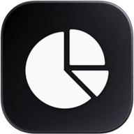
</a>

# Ledgio

### Money management with pure *clarity*.

A private, offline-first budgeting app that shows you where every rupee goes.<br>
Free forever. No ads. No paywalls. Open source.

<br>

[](https://ledgio.pages.dev/)
&nbsp;
[](#-install-it-like-an-app)

<br>

[](https://github.com/Code-Breaker-Ctrl/Ledgio/commits/main)
[](LICENSE)
[](https://github.com/Code-Breaker-Ctrl/Ledgio/actions/workflows/runtime-gate.yml)
[](https://github.com/Code-Breaker-Ctrl/Ledgio/commits/main)
[](https://github.com/Code-Breaker-Ctrl/Ledgio/stargazers)
<br>
[](#-tech-stack)
[](https://supabase.com)
[](#-install-it-like-an-app)
[](https://hub.xerj.org/contributors/Code-Breaker-Ctrl)

<br>

**[Features](#-features)** · **[Screenshots](#-a-quick-look)** · **[How it works](#-how-it-works)** · **[Self-host](#-run-your-own-copy)** · **[Development](#-development)** · **[Roadmap](#-roadmap)** · **[Contributing](#-contributing)**

<br>

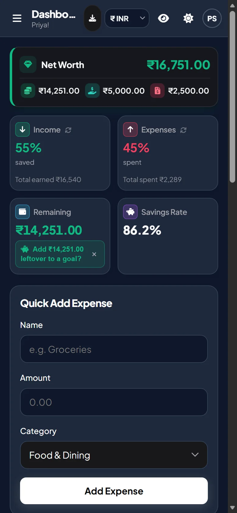
&nbsp;&nbsp;
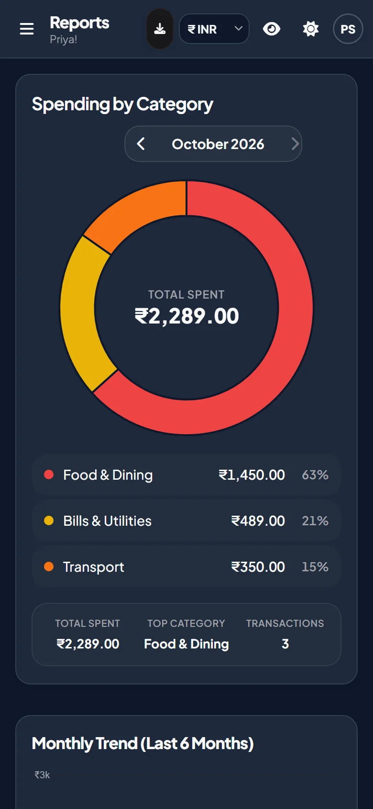
&nbsp;&nbsp;
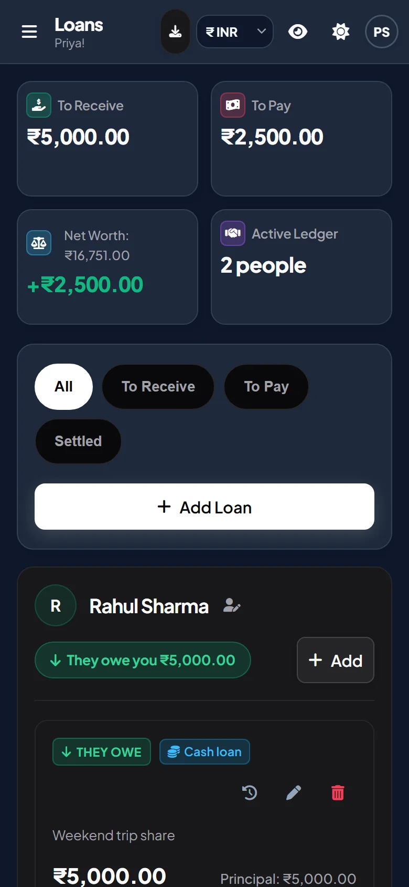

</div>

<br>

## 💡 Why Ledgio?

Most money stress isn't about how much you earn. It's about not knowing where it went.

Ledgio is a calm, honest ledger for your money. You log what you earn and spend, set limits for the categories that matter, put money aside for goals, and keep track of who owes whom. Everything is **saved on your device first**, so it works offline and opens instantly. When you sign in, it **syncs to your own private account** so your phone and laptop stay in step.

<table>
<tr>
<td align="center" width="25%">🔒<br><b>Private by design</b><br><sub>Local-first storage. Your cloud data is isolated to your account with Row Level Security.</sub></td>
<td align="center" width="25%">📴<br><b>Works offline</b><br><sub>Edits queue up offline and sync automatically when you're back online.</sub></td>
<td align="center" width="25%">💸<br><b>Free forever</b><br><sub>No subscriptions, no paywalls, no ads, no data selling.</sub></td>
<td align="center" width="25%">🧾<br><b>Yours to keep</b><br><sub>Export everything to CSV or JSON whenever you like.</sub></td>
</tr>
</table>

<br>

## ✨ Features

<table>
<tr>
<td width="50%" valign="top">

### 📊 Dashboard at a glance
Net worth, income, expenses, what's remaining and your savings rate, all on one screen. Tap the Income or Expenses card to flip between **₹ amounts and % of income**.

### 🏷️ Categories & spending limits
10 built-in categories plus your own (**15 in total**), each with an icon and colour. Set a monthly limit per category and watch the bar move from green to amber to red as you approach it.

### 🎯 Savings goals
Create goals with a target and a date, add or withdraw money, and see progress at a glance. Got money left over this month? Ledgio offers to move it into a goal.

### 🤝 Loans & debts
Track money you **lent** and money you **borrowed**, including bills someone paid for you. Record partial settlements and see the full repayment history per person.

</td>
<td width="50%" valign="top">

### 💵 Income & pay cycles
A dated income ledger with opening balances and adjustments. Set your **payday** (1st–28th) so months follow your salary, and optionally auto-credit a **recurring salary** each cycle.

### 📈 Reports
Spending by category as a donut chart with a tappable legend, plus a 6-month trend. Pick any month to look back.

### 🛡️ Private vault
Lock the app behind a **4-digit PIN** (salted SHA-256), with optional **biometric unlock** via WebAuthn, auto-lock, and a **stealth mode** that masks every amount on screen.

### 🌍 12 currencies, light & dark
INR, USD, EUR, GBP, AED, SGD, CAD, AUD, JPY, SAR, BDT and NPR with native formatting. Polished light and dark themes on phone, tablet and desktop.

</td>
</tr>
</table>

<br>

## 📸 A quick look

<div align="center">

| Dashboard (light) | Budgets | Savings goals |
|:---:|:---:|:---:|
| 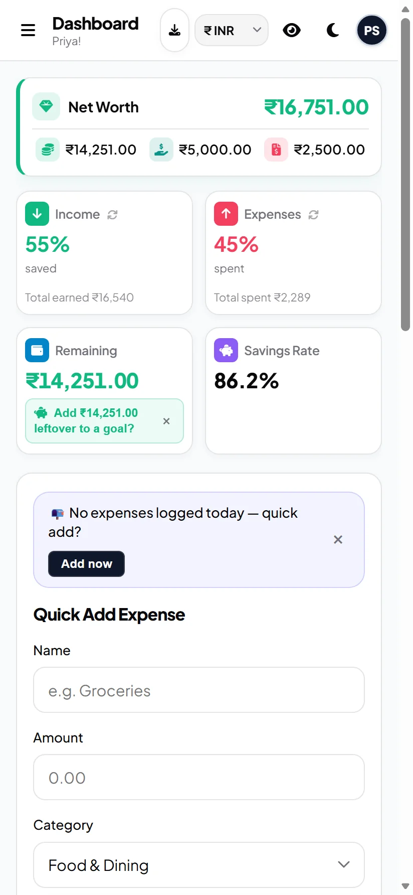 | 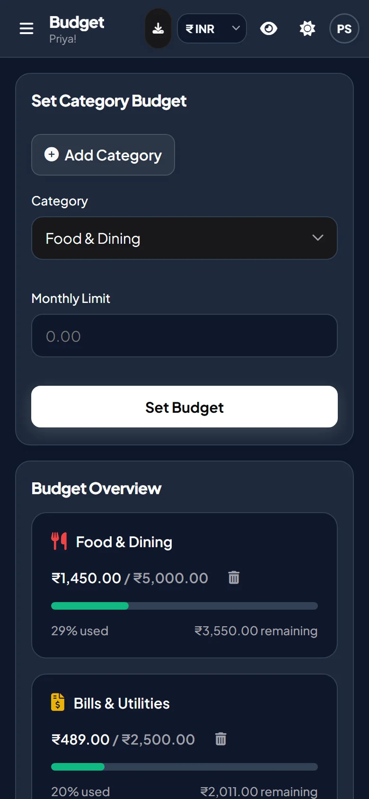 | 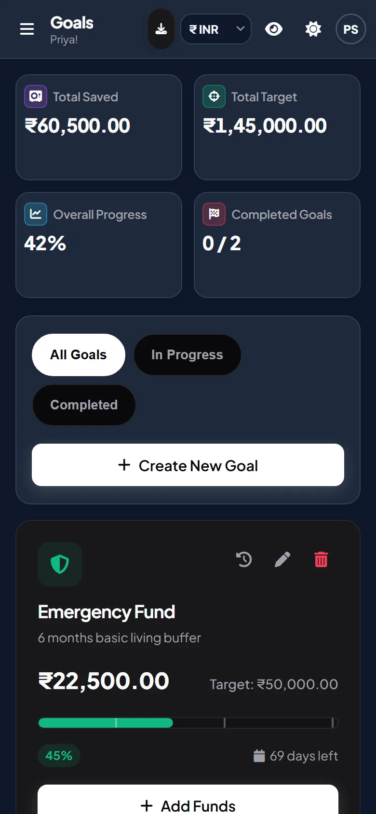 |
| **Record a loan** | **Categories** | **Income vs spend in %** |
| 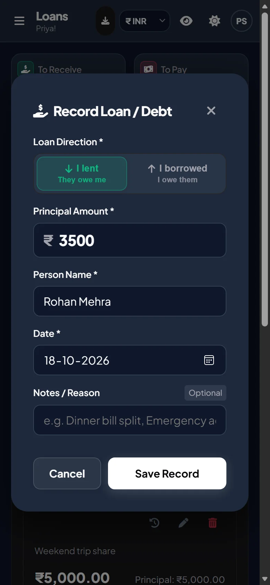 | 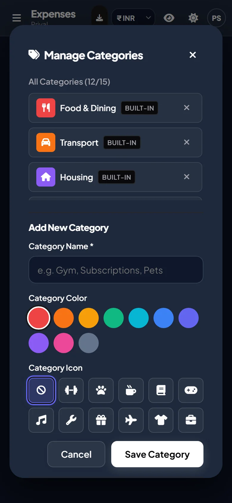 | 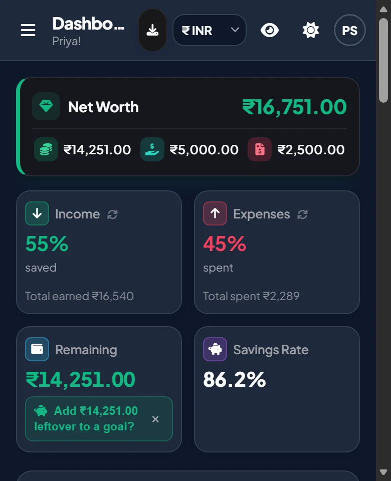 |

<sub>Real screenshots of the app with a demo account.</sub>

</div>

<br>

## 📲 Install it like an app

Ledgio is a Progressive Web App: install it once and it opens full-screen, works offline and launches from your home screen or dock.

| Platform | How |
|:---|:---|
| 🤖 **Android** (Chrome) | Open the [live app](https://ledgio.pages.dev/) → tap **Install App** (or ⋮ → *Install app*) |
| 🍎 **iPhone / iPad** (Safari) | Open the live app → tap **Share** ⬆ → **Add to Home Screen** |
| 💻 **Windows / macOS / Linux** (Chrome or Edge) | Open the live app → click the **install icon** in the address bar |
| 🧩 **In-app browsers** (Instagram, WhatsApp…) | Tap ⋮ → **Open in Chrome** first, then install |

<br>

## 🧠 How it works

Ledgio is **local-first**: every change is written to your device immediately and queued for sync. The sync engine replays the queue to Supabase in order when you're online, retries with backoff when you're not, and quarantines anything the server permanently rejects so nothing is silently lost.

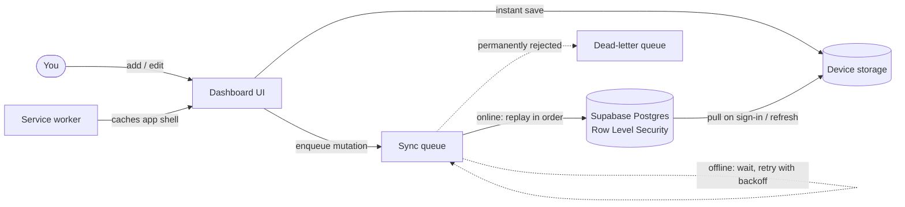

<details>
<summary><b>🧩 Modules</b></summary>

<br>

The app is plain JavaScript split into domain modules. Each module exposes a small namespace and receives what it needs from `app.js` through a `configure({ ... })` bridge.

| Module | Namespace | Responsibility |
|:---|:---|:---|
| `supabase-config.js` | `SUPABASE_CONFIG` | Project URL/anon key, admin ids, the single Supabase client factory, app version |
| `sync-engine.js` | `LedgioSyncEngine` | Offline FIFO mutation queue, per-record ordering, backoff, auth refresh, dead-letter queue |
| `income.js` | `LedgioIncome` | Dated income ledger, opening balances, pay-cycle ranges, deterministic ids |
| `expenses.js` | `LedgioExpenses` | Expenses, category limits, 80% / 100% warnings |
| `categories.js` | `LedgioCategories` | Built-in + custom categories (max 15), cloud roaming, safe reassignment |
| `goals.js` | `LedgioGoals` | Savings goals and their deposit ledger |
| `loans.js` | `LedgioLoans` | Lent / borrowed ledger, cash vs paid-on-your-behalf, settlements |
| `vault.js` | `LedgioVault` | PIN lock (salted SHA-256), WebAuthn unlock, auto-lock, stealth masking |
| `auth.js` | — | Email + Google/GitHub sign-in, password reset, session handling, logout cleanup |
| `pwa-installer.js` | — | Install prompts, platform guides, anonymous install/launch counts |
| `app.js` | — | Startup sequence, rendering, charts, settings, recurring salary, glue |

</details>

<details>
<summary><b>🗄️ Database schema</b></summary>

<br>

Eleven tables, every one protected by Row Level Security. Goal and loan balances are **computed** from their deposit and settlement records, never stored.

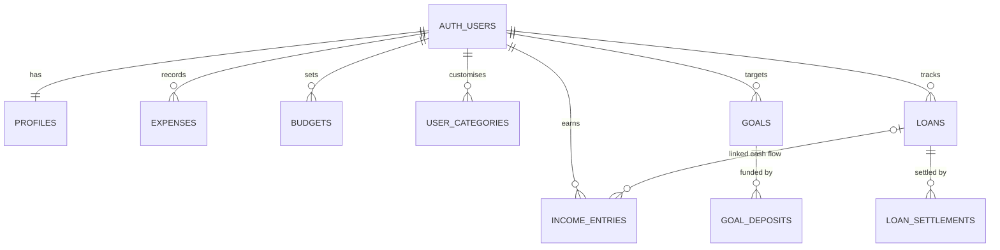

| Table | What it holds | Access |
|:---|:---|:---|
| `profiles` | Name, currency, theme, income baseline, hidden built-ins, reset epoch | Own row only, `USING` + `WITH CHECK` |
| `expenses` | Name, amount, category, date | Own rows only |
| `budgets` | Monthly limit per category | Own rows, unique per category |
| `income_entries` | Dated income: add / opening / adjustment, optional loan link | Own rows only |
| `user_categories` | Custom category name, icon, colour | Own rows, unique name per user |
| `goals` / `goal_deposits` | Goal metadata and signed deposits | Own rows; deposits cascade with goal |
| `loans` / `loan_settlements` | Direction, kind, principal; settlements | Own rows; settlements cascade with loan |
| `announcements` | In-app broadcast messages | Read: signed-in users · Write: admin |
| `app_analytics` | Anonymous install / launch counts (no user id) | Insert: constrained · Read: admin |

</details>

<br>

## 🛠️ Tech stack

| | |
|:---|:---|
| **Frontend** | Vanilla JavaScript (ES2020+), HTML, CSS: no framework, no bundler |
| **Backend** | [Supabase](https://supabase.com): Postgres, Row Level Security, Auth (email, Google, GitHub) |
| **Offline** | Service worker app-shell cache, local-first storage, custom sync queue |
| **Charts** | [Chart.js](https://www.chartjs.org/) |
| **Security** | Web Crypto (salted SHA-256 PIN), WebAuthn biometric unlock |
| **Type & icons** | Plus Jakarta Sans, Space Grotesk, Instrument Serif, Font Awesome 6 |
| **Hosting** | Cloudflare Pages (<https://ledgio.pages.dev/>) |
| **Quality** | 334 headless-browser runtime gates, innerHTML security audit, overflow & desktop-parity checks |

<br>

## 🚀 Run your own copy

<details open>
<summary><b>1. Clone and serve locally</b></summary>

<br>

```bash
git clone https://github.com/Code-Breaker-Ctrl/Ledgio.git
cd Ledgio
python -m http.server 8000
```

Open <http://localhost:8000>. Any static file server works; there's nothing to compile to run it.

</details>

<details>
<summary><b>2. Create your Supabase project and run the SQL</b></summary>

<br>

In the [Supabase SQL editor](https://supabase.com/dashboard), run these files **in order**:

| # | File | Adds |
|:---:|:---|:---|
| 1 | `backend/supabase-schema.sql` | Base tables and RLS policies |
| 2 | `backend/migrations/phase3_offline_sync.sql` | Sync timestamps and triggers |
| 3 | `backend/migrations/phase4_savings_goals.sql` | Goals and deposits |
| 4 | `backend/migrations/phase5_loans.sql` | Loans and settlements |
| 5 | `backend/migrations/phase5b_announcements.sql` | Announcements |
| 6 | `backend/migrations/phase5c_analytics_rls.sql` | Analytics read lockdown |
| 7 | `backend/migrations/phase5d_analytics_hardening.sql` | Analytics constraints |
| 8 | `backend/migrations/phase6_income_entries.sql` | Income ledger |
| 9 | `backend/migrations/phase6b_loan_linked_income.sql` | Loan ↔ income links |
| 10 | `backend/migrations/phase7_categories.sql` | Custom categories |
| 11 | `backend/migrations/phase7b_reset_epoch.sql` | Multi-device reset epoch |
| 12 | `backend/migrations/phase8_loan_kinds.sql` | Cash vs paid-on-your-behalf loans |
| 13 | `backend/migrations/phase9_hardening.sql` | Stricter profile and analytics policies |
| 14 | `backend/migrations/phase9b_analytics_userid.sql` | Analytics cannot carry another user's id |
| 15 | `backend/migrations/phase10_analytics_retention.sql` | Nightly clean-up of launch analytics older than 90 days |
| ✓ | `backend/verify_schema_phase9.sql` | Optional: prints PASS/FAIL for the security policies |

</details>

<details>
<summary><b>3. Point the app at your project</b></summary>

<br>

Edit `assets/js/supabase-config.js`:

```javascript
window.SUPABASE_CONFIG = {
  url: 'https://your-project.supabase.co',
  anonKey: 'your-anon-public-key'   // the public anon key, never the service-role key
};
window.LEDGIO_ADMIN_USER_IDS = ['your-admin-user-uuid'];  // optional
```

Then in **Supabase → Authentication → URL Configuration**:

- **Site URL**: where you host it, e.g. `https://ledgio.pages.dev` (or `https://<you>.github.io/Ledgio/`)
- **Redirect URLs**: add `/dashboard.html`, `/login.html` and `/reset-password.html` on that domain
- Enable **Google** and/or **GitHub** under *Providers* if you want social sign-in

</details>

<details>
<summary><b>4. Deploy</b></summary>

<br>

Push to GitHub and enable **Settings → Pages → Deploy from branch → `main` / root**. Any static host (Netlify, Vercel, Cloudflare Pages) works the same way.

</details>

<br>

## 💻 Development

The source files (`*.js`, `*.css`) are what you edit; the `*.min.*` files are generated. All tooling is PowerShell and runs on Windows (or PowerShell 7 elsewhere) with Microsoft Edge installed for the headless checks.

| Command | What it does |
|:---|:---|
| `scripts/build.ps1` | Minifies JS/CSS, syncs SQL migrations, and **fails** if the version differs between `supabase-config.js`, `sw.js`, this README badge and any `?v=` in the HTML files |
| `scripts/test_runtime_gate.ps1` | Runs **334 runtime gates** in headless Edge against `tests/headless_regression.html` (sync engine, accounting, vault, viewport, landing page integrity and more) |
| `scripts/verify_innerhtml_audit.ps1` | Checks that every `innerHTML` sink is listed and reviewed in [`docs/security/innerhtml-audit.md`](docs/security/innerhtml-audit.md) |
| `scripts/check_overflow.ps1` | Fails if the landing page scrolls sideways at 360–1440px |
| `scripts/verify_desktop_parity.ps1` | Pixel-compares desktop and tablet screenshots before and after a change |

```powershell
powershell -ExecutionPolicy Bypass -File scripts\build.ps1
powershell -ExecutionPolicy Bypass -File scripts\test_runtime_gate.ps1
```

### 📋 Pre-Release Verification Checklist

Every release must verify the following automated gates and checks before tagging:

1. **Minification & Asset Verification**: Run `scripts/build.ps1` — validates version string parity across `supabase-config.js`, `sw.js`, `README.md`, and HTML files; ensures all referenced scripts, styles, icons, and images exist; runs `node --check` on all minified bundles.
2. **Horizontal Overflow Audit**: Run `scripts/check_overflow.ps1` — validates zero horizontal overflow from 320px to 1440px viewports.
3. **Runtime Regression Suite**: Run `scripts/test_runtime_gate.ps1` — ensures all 334+ automated DOM runtime assertions pass (0 failures).
4. **Live Smoke Test**: Verify core flows (index, login, signup, reset-password, dashboard) on `https://ledgio.pages.dev` with zero console errors and <1s local-first paint.

<details>
<summary><b>📂 Project layout</b></summary>

```
Ledgio/
├── index.html              Landing page
├── login.html · signup.html · reset-password.html
├── terms.html · privacy.html
├── dashboard.html          The app
├── sw.js                   Service worker (app-shell cache)
├── manifest.json           PWA manifest + shortcuts
├── assets/
│   ├── css/                styles.css (site + shared), dashboard.css (app)
│   ├── js/                 domain modules, see "How it works"
│   ├── img/landing/        real app screenshots (WebP)
│   └── icons/
├── backend/                schema, migrations, verification SQL
├── supabase/migrations/    mirror of backend/migrations (synced by build)
├── scripts/                build, tests, screenshot and audit tooling
├── tests/                  headless regression and screenshot harnesses
└── docs/                   security audit, UI review screenshots, debugging notes
```

</details>

<br>

## 🔐 Privacy & security

- **Your data stays yours.** Ledgio is saved on your device first; cloud copies live in your own rows, isolated by Postgres Row Level Security.
- **No ads, no trackers, no data selling.** The only analytics are anonymous install and launch counts, and they are **not linked to your account**.
- **No bank connections.** Ledgio never asks for bank logins or card details.
- **Hardened by default.** Escaped HTML rendering (audited and [indexed by XERJ Corpus Hub](https://hub.xerj.org/contributors/Code-Breaker-Ctrl)), PIN hashing with Web Crypto, strict RLS on every table.

Read the full [Privacy Policy](https://ledgio.pages.dev/privacy.html) and [Terms](https://ledgio.pages.dev/terms.html). Found a security issue? Please open a [private security advisory](https://github.com/Code-Breaker-Ctrl/Ledgio/security/advisories/new) instead of a public issue.

<br>

## 🗺️ Roadmap

- [x] Offline-first sync engine with dead-letter queue
- [x] Savings goals, loans & debts, custom categories
- [x] Custom pay cycles and recurring salary
- [x] Private vault with PIN, biometrics and stealth mode
- [x] Password reset, Terms and Privacy pages
- [x] Landing page v2 and mobile redesign
- [ ] 📄 PDF monthly and yearly statements
- [ ] 📦 Play Store packaging (TWA) with native biometric prompt

Have an idea? [Open a feature request](https://github.com/Code-Breaker-Ctrl/Ledgio/issues/new).

<br>

## 🤝 Contributing

Contributions are welcome: bug reports, ideas, docs and code.

1. **Fork** the repo and create a branch: `git checkout -b feat/my-idea`
2. Edit the **source** files (not `*.min.*`), then run `scripts/build.ps1`
3. Run `scripts/test_runtime_gate.ps1` and make sure every gate passes
4. Use [Conventional Commits](https://www.conventionalcommits.org/) (`feat(loans): …`, `fix(sync): …`)
5. Open a **pull request** describing what changed and why. The runtime gates run automatically on every PR.

Please keep claims in the UI and docs truthful: if the app doesn't do it, don't say it does.

<br>

## 📄 License

Released under the [MIT License](LICENSE). Use it, learn from it, build on it.

<br>

<div align="center">

**If Ledgio helps you see your money more clearly, consider giving it a ⭐**

[](https://github.com/Code-Breaker-Ctrl/Ledgio/stargazers)

<sub>Built with care by <a href="https://github.com/Code-Breaker-Ctrl">Code-Breaker-Ctrl</a> · <a href="https://ledgio.pages.dev/">Live app</a> · <a href="https://github.com/Code-Breaker-Ctrl/Ledgio/issues">Report a bug</a></sub>

</div>
