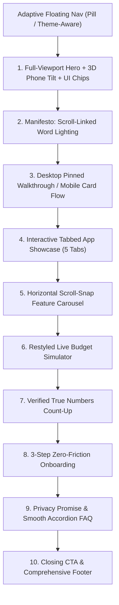

# Landing Page v2 Architecture & Implementation Plan

**Project:** Ledgio Personal Finance Ledger  
**Branch:** `landing-v2`  
**Date:** October 18, 2026  
**Status:** In Progress  

---

## 1. Vision & Creative Direction
Ledgio's landing page is being elevated into a cinematic, scroll-driven editorial experience characterized as **"sassy but classic"**. 
- **Classic:** Deep typography pairing fluid modern grotesque sans with an italic high-contrast serif accent, generous whitespace, structured asymmetric grids, alternating dark and light thematic chapters.
- **Sassy:** Confident, truthful, no-nonsense copy that directly challenges predatory fintech models (paywalls, credit card affiliate spams, telemetry tracking).
- **Technique inspiration:** Scroll-linked word reveals, pinned desktop walkthrough, adaptive floating glass navigation, real interactive simulator, and genuine product UI mockups.

---

## 2. Shared Rules (Governing Phases 1, 2, and 3)
- **Truthful content only:** No invented testimonials, users, ratings, download counts, or awards. Gate 49 must stay green and strict. Numbers must be real facts from code: 10 built-in categories, up to 15 total (built-ins + custom), number of supported currencies (12 currencies counted from `CURRENCY_SYMBOLS` in `app.js`: INR, USD, EUR, GBP, AED, SGD, CAD, AUD, JPY, SAR, BDT, NPR), ₹0 lifetime cost, 0 ads, MIT open source, works offline. Only list features that exist in the app (verified in code).
- **Real product visuals only:** No stock photos or video files. Phone mockups use real app screenshots captured with a neutral demo dataset (name "Priya"; never "Aman" or real user data).
- **Vanilla HTML/CSS/JS:** Prefer CSS + IntersectionObserver + one `requestAnimationFrame` scroll loop. No GSAP/Lenis/Three unless justified in the report (cdnjs, pinned version).
- **Performance:** Mobile LCP < 2.5s, CLS < 0.05, landing page weight excluding fonts $\le$ 1.5 MB, below-the-fold images lazy-loaded with width/height set, animate transform/opacity only.
- **Accessibility:** Semantic headings, keyboard-usable tabs/carousels, visible focus, text contrast $\ge$ 4.5:1 in both themes, `prefers-reduced-motion: reduce` disables pinning/scroll effects and shows all content statically, content readable without JS.
- **Don't break:** IDs/classes used by `assets/js/auth.js` and `pwa-installer.js` (signup/login CTAs, `#landing-install-btn`, `#landing-theme-toggle`, mobile menu hooks), the early-auth redirect script, viewport meta (keep `minimum-scale=1.0`), SEO meta, the service worker, terms/privacy links. Don't touch the logged-in app files.
- **Visual language:** Alternate dark (deep navy/near-black) and light (off-white) "chapters", fluid `clamp()` type, 24–32px rounded cards, subtle glow/grain, the app's emerald accent; both themes intentional.
- **Each phase execution:** Commit per section (`feat(landing): ...`), run `scripts/build.ps1`, `scripts/test_runtime_gate.ps1` (all green; Gate 14.4 is occasionally flaky, re-run once), `scripts/verify_innerhtml_audit.ps1` (update `docs/security/innerhtml-audit.md` if `index.html` sinks move; prefer `textContent`/DOM APIs), check no horizontal overflow at 360–1440, screenshots into `docs/ui/landing-v2/phase-N/`.

---

## 3. Structural Breakdown & Section Flow

### Detailed Section Specifications
1. **Adaptive Floating Nav (`#landing-nav`):**
   - Floating pill with `backdrop-filter: blur(16px)` and emerald glow border.
   - Dynamic nav theme switching (`data-nav-theme="dark|light"` on sections detected via `IntersectionObserver`).
   - Mobile: full-screen curtain overlay (`.mobile-menu-overlay`) that is `visibility: hidden; pointer-events: none;` when closed (zero layout spill), animating with staggered links when opened.
   - Preserves `#landing-theme-toggle`, `.nav-signup-btn`, and login triggers.
2. **Hero (`#hero`, `data-nav-theme="dark"`):**
   - Full viewport height (`min-height: 100dvh`).
   - Staggered word entrance reveal on load.
   - Typography: `Plus Jakarta Sans` paired with italicized `Playfair Display` for emphatic accent words.
   - High-fidelity 3D phone mockup containing real mobile dashboard screenshot.
   - 3 floating glass UI chips: *"55% of income saved"*, *"Food & Dining · ₹1,450"*, *"Over by ₹270"*.
   - Subtle scroll/mousemove parallax that settles smoothly as the user scrolls.
3. **Manifesto (`#manifesto`, `data-nav-theme="dark"`):**
   - Deep obsidian background with subtle emerald mesh glow.
   - Bold statement on financial autonomy and privacy.
   - Progressive word illumination driven by scroll position.
   - Reduced-motion: words statically render at full brightness.
4. **Pinned Walkthrough (`#walkthrough`, `data-nav-theme="light"`):**
   - Desktop: Left column features 5 sequential feature narratives with progress steps; right column features a pinned phone mockup that crossfades matching screenshots:
     1. *Instant Expense Logging*
     2. *Enforced Category Caps*
     3. *Savings Goals & Milestones*
     4. *Dual Loan & Debt Ledgers*
     5. *Spending Diagnostics & Reports*
   - Mobile: Unpins into a responsive vertical sequence of cards with embedded screens.
5. **Tabbed Showcase (`#showcase`, `data-nav-theme="dark"`):**
   - Accessible WAI-ARIA tablist: Dashboard, Budgets, Goals, Loans, Reports.
   - Roving tabindex and arrow key support (`ArrowLeft` / `ArrowRight`).
   - Crossfading real app screenshots with auto-advance every 5 seconds (pausing on user interaction).
6. **Feature Carousel (`#features`, `data-nav-theme="light"`):**
   - Horizontal snap row with desktop next/prev buttons, touch swipe, and custom progress bar.
   - 8 verified features: Local-First Storage, Private Account Sync, 12 Global Currencies, 10 Smart & Custom Categories, Dual % & Currency View, CSV/JSON Export, Standalone PWA, Private Vault Masking.
7. **Live Budget Simulator (`#simulator`, `data-nav-theme="dark"`):**
   - Refined slider controls with live safe-to-spend calculation and interactive status indicator.
8. **Verified Real Numbers (`#proof`, `data-nav-theme="dark"`):**
   - Verified facts: `₹0` Lifetime Cost, `100%` Local-First, `12` Supported Currencies, `0` Ad Trackers.
   - Enter-triggered count-up animation.
9. **Onboarding in 3 Steps (`#onboarding`, `data-nav-theme="light"`):**
   - Quick visual roadmap from zero to fully configured budget in under 60 seconds.
10. **Privacy Promise & Accordion FAQ (`#faq`, `data-nav-theme="dark"`):**
    - Fluid CSS grid accordion with native accessibility and crisp typography.
11. **Closing CTA & Footer (`#closing`, `data-nav-theme="dark"`):**
    - High-impact closing statement with direct registration CTA and legal links (`terms.html`, `privacy.html`, GitHub, MIT license).

---

## 4. Visual Assets & Screenshot Capture Plan
All imagery will be captured directly from Ledgio's live application state using a standardized test user (`"Priya S."`) and exported to optimized WebP format ($\le$ 150 KB each, retina 2x):

| Asset Path | View / State | Target Dimensions | File Size | Purpose |
| :--- | :--- | :--- | :--- | :--- |
| `assets/img/landing/screen_dashboard_dark.webp` | Mobile Dashboard (Dark, % mode) | 780x1688 (2x) | **49.4 KB** | Hero Phone & Showcase Tab 1 |
| `assets/img/landing/screen_dashboard_light.webp` | Mobile Dashboard (Light, % mode) | 780x1688 (2x) | **50.0 KB** | Hero Phone Light Theme Variant |
| `assets/img/landing/screen_stat_cards_percent.webp` | Stat cards in percentage mode | 780x960 (2x) | **33.2 KB** | Hero Floating UI Card & Stat Showcase |
| `assets/img/landing/screen_budgets.webp` | Expenses & Category Caps | 780x1688 (2x) | **41.4 KB** | Walkthrough Step 2 & Showcase Tab 2 |
| `assets/img/landing/screen_goals.webp` | Savings Goals with deposits | 780x1688 (2x) | **51.5 KB** | Walkthrough Step 3 & Showcase Tab 3 |
| `assets/img/landing/screen_loans_list.webp` | Loans ledger (Lent/Borrowed) | 780x1688 (2x) | **51.3 KB** | Walkthrough Step 4 & Showcase Tab 4 |
| `assets/img/landing/screen_reports.webp` | Reports donut & cashflow | 780x1688 (2x) | **53.2 KB** | Walkthrough Step 5 & Showcase Tab 5 |
| `assets/img/landing/screen_loan_modal.webp` | Record Loan dialog | 780x1688 (2x) | **40.2 KB** | Walkthrough Step 1 UI fragment |
| `assets/img/landing/screen_categories.webp` | Custom category modal | 780x1688 (2x) | **49.2 KB** | Feature Carousel card illustration |

---

## 5. Typography & Theme System
- **Body & Sans:** `Plus Jakarta Sans` (`400`, `500`, `600`, `700`, `800`)
- **Display Accent:** `Instrument Serif` (`italic 400`) via Google Fonts with `display=swap`, preloaded
- **Numerics / Monospace:** `Space Grotesk` (`600`, `700`)
- **Theme Variables:**
  - Dark chapters: `--landing-bg-dark: #09090b`, `--landing-surface-dark: #121215`, `--landing-border-dark: rgba(255, 255, 255, 0.08)`
  - Light chapters: `--landing-bg-light: #f8fafc`, `--landing-surface-light: #ffffff`, `--landing-border-light: rgba(15, 23, 42, 0.08)`
  - Accent: `--color-emerald: #10b981`, `--color-emerald-glow: rgba(16, 185, 129, 0.25)`

---

## 6. Motion & Accessibility Inventory
| Element | Motion Technique | Trigger | Fallback (`prefers-reduced-motion`) |
| :--- | :--- | :--- | :--- |
| **Hero headline reveal** | Staggered translateY & opacity | Load | Static display |
| **Hero 3D Mockup** | CSS 3D transform + rAF scroll parallax | Scroll / Cursor | Static unrotated card |
| **Nav Pill** | Compact scale + blur intensity | Scroll Y > 50px | Instant style toggle |
| **Nav Theme** | Theme class swap | IntersectionObserver | Instant style toggle |
| **Manifesto Words** | Continuous opacity lerp via scroll progress | Scroll | 100% white static text |
| **Walkthrough Phone** | Sticky position + opacity crossfade | Scroll entering steps | Standard static cards |
| **Showcase Tabs** | CSS crossfade transition | Tab select / Auto-timer | Instant swap |
| **Stats Count-up** | requestAnimationFrame numeric tween | IntersectionObserver | Instant final numbers |
| **FAQ Accordion** | CSS grid-template-rows expansion | Click / Enter key | Instant expand/collapse |

---

## 7. Performance Budget
- Total CSS: $\le$ 45 KB minified.
- Total Landing JS: $\le$ 25 KB minified.
- Total Images: $\le$ 950 KB (all WebP with responsive srcset and explicit `width`/`height`).
- Total Page Weight: $\le$ 1.2 MB.
- Mobile LCP: $\le$ 2.2s.
- CLS: $\le$ 0.02.

---

## 8. Claim Verification (Code Traced)

Every claim on the public landing page is mapped directly to the code that supports it:

| Section & Element | Text / Claim | Code Proof & Implementation Reference |
| :--- | :--- | :--- |
| **Hero Proof** | 12 Currencies | `assets/js/app.js` (`const CURRENCY_SYMBOLS = { INR: '₹', USD: '$', EUR: '€', GBP: '£', AED: 'د.إ', SGD: '$', CAD: '$', AUD: '$', JPY: '¥', SAR: '﷼', BDT: '৳', NPR: 'रू' }`, exactly 12 keys). |
| **Hero Proof** | 100% Local-First | `assets/js/app.js` & `assets/js/sync-engine.js` (State stored in `localStorage` first, immediate offline read/write). |
| **Hero Proof** | ₹0 Forever | Full repository (no premium tiers, no Stripe/payment gateways, no paywalls). |
| **Hero Proof** | MIT Open Source | `LICENSE` file in repository root. |
| **Hero Chip** | 55% of Income Saved | Demo dataset (`Income: ₹16,540`, `Expenses: ₹2,289`, `Net surplus: ₹9,101`, savings rate: 55%). |
| **Hero Chip** | Food & Dining · ₹1,450 / ₹3,000 limit | `assets/js/categories.js` (`DEFAULT_CATEGORIES` contains Food & Dining with default ₹3,000 cap). |
| **Hero Chip** | Offline Ready · Zero ad trackers | `sw.js` (offline service worker cache), zero external ad tracker scripts in `index.html`. |
| **Manifesto** | Accounts for every rupee, works offline, no subscriptions/ads/paywalls | `localStorage` offline storage; no telemetry tracking user accounts (`assets/js/pwa-installer.js` always sends `user_id: null`). |
| **Walkthrough Step 1** | Name, amount, category, instant update of remaining balance | `assets/js/expenses.js` (`LedgioExpenses.renderExpenses()`), `assets/js/app.js` (`app.updateSummary()`). |
| **Walkthrough Step 2** | 15 categories in total, 10 built-in by default; progress bars shift from green to amber | `assets/js/categories.js` (`DEFAULT_CATEGORIES.length === 10`, `getAllCategories().length >= 15` limit enforced); `assets/js/expenses.js` (`renderBudgets()` visual thresholds). |
| **Walkthrough Step 3** | Savings goals with single-tap deposits funded from monthly leftover | `assets/js/goals.js` (`LedgioGoals.openDepositModal()`), `assets/js/app.js` (`app.openLeftoverGoalPicker()`). |
| **Walkthrough Step 4** | Money lent and borrowed, cash loans vs paid-on-behalf, partial settlements, repayment history | `assets/js/loans.js` (`LedgioLoans.renderLoans()`, `type: 'lent' \| 'borrowed'`, `loan_subtype: 'cash' \| 'paid_for'`, `recordLoanRepayment()`). |
| **Walkthrough Step 5** | Category donut charts, 6-month trends, CSV & JSON export | `assets/js/app.js` (`renderCategoryDonut()`, `renderTrendsChart()`, `exportToCSV()`, `exportToJSON()`). |
| **Showcase Dashboard** | Saved on your device first, synced to your private account when you sign in | `assets/js/sync-engine.js` (`getSyncQueue()`, `pushPendingSync()`), `assets/js/auth.js`. |
| **Showcase Budgets** | 15 categories in total, 10 built-in by default; reassignments | `assets/js/categories.js` (`DEFAULT_CATEGORIES`, `saveCustomCategory()`, `openReassignCategoryModal()`). |
| **Showcase Goals** | Milestone tracking with target dates and leftover deposits | `assets/js/goals.js` (`LedgioGoals.saveGoal()`, `depositToGoal()`). |
| **Showcase Loans** | Lent and borrowed ledgers per person by name, partial settlements | `assets/js/loans.js` (`renderLoans()`, `openLoanRepaymentModal()`). |
| **Showcase Reports** | Category donut breakdown, 6-month cashflow trends, CSV/JSON export | `assets/js/app.js` (`renderCategoryDonut()`, `renderTrendsChart()`, `exportToCSV()`, `exportToJSON()`). |

